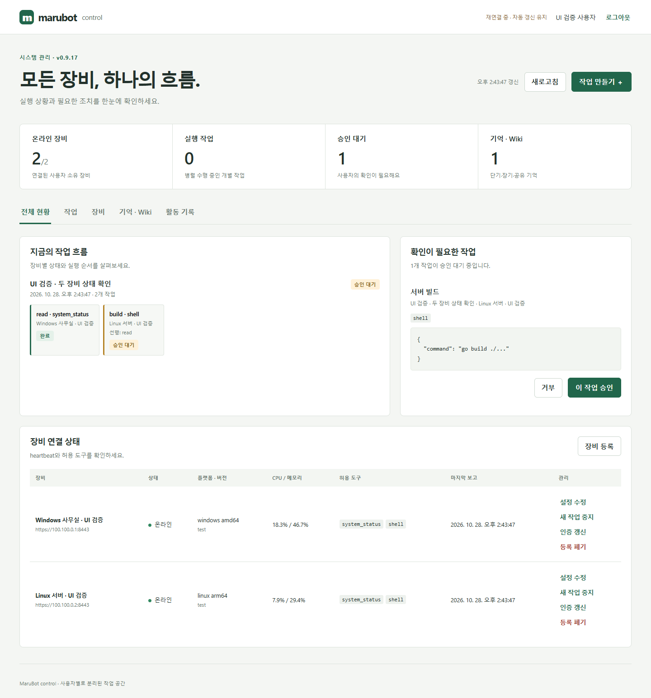
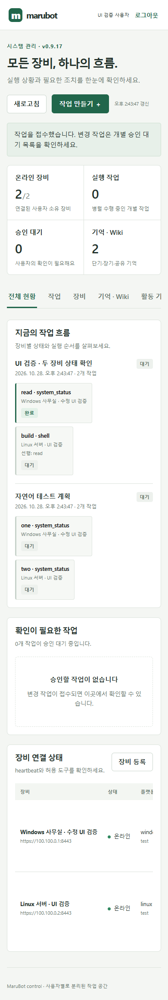

# 검증과 운영 확인

## 자동 검증

저장소 루트에서 실행한다.

```powershell
go test ./...
go vet ./...
go build -o build/maru-admin.exe ./admin/backend
go build -o build/marubot.exe ./cmd/marubot
node --check admin/frontend/app.js
node --check admin/frontend/forms.js
```

검증 대상:

- 독립 작업의 동시 실행, 선행 단계 완료 대기, 개별 승인과 거부·만료.
- 같은 요청 재전송과 다른 본문의 멱등 키 충돌, worker 실행 journal 재사용.
- 사용자별 DB 격리, 타 사용자 장비 폐기·작업·이벤트·기억 접근 차단.
- worker TLS 통신과 취소, unknown 결과의 장비 기록 재조회. 재조회 시 도구를 다시 실행하지 않음.
- OAuth state·PKCE 생성, nonce·issuer·audience·만료 검증, RSA 서명 변조 거부.
- CSRF 검증, 장비 역할별 API 차단, 토큰 폐기.
- 원격 workspace 접근, 비밀 파일·상위 디렉터리·재위임 도구 거부.
- 단기 기억 만료, Wiki 승격, revision 충돌과 삭제 시 이력 삭제.
- 영속 SSE Last-Event-ID 재전송, 최근 500개 활동 기록 조회.

## Chrome UI smoke

Playwright와 로컬 Chrome이 필요하다. Playwright 모듈 경로를 `PLAYWRIGHT_MODULE`로 지정하거나 Node에서 `require('playwright')` 가능한 환경에서 실행한다.

```powershell
node tools/admin-ui-smoke.cjs
```

빌드된 Admin을 임시 데이터 디렉터리와 18180 포트로 실행한다. 로그인 설정 상태와 미인증 API 차단은 실제 backend에서 확인한다. 인증 후 화면 조작은 브라우저에서 테스트용 응답을 주입한다. 운영 API에 로그인 우회나 가상 장비 데이터를 추가하지 않는다.

현황·개별 승인·기억 저장·장비 수정·일시중지/재개·등록·일회 토큰 닫기 후 제거·자연어 2단계 계획 제출·모바일 가로 넘침·브라우저 JavaScript 오류를 검사한다.

아래 화면은 테스트 데이터다.





## 실제 환경에서 남은 확인

실제 Google OAuth client와 등록된 callback 주소로 로그인한다. 장비별 유효 TLS 인증서·Tailscale 경로·Google 소유자와 노드 토큰을 설정한 뒤 Windows/Linux/RPi 두 대 이상에서 system_status 병렬 작업을 수행한다. 셸·GPIO 등 OS/하드웨어 도구는 해당 장비에서 개별 검증한다. 자동 테스트만으로 실제 운영 장비 배포 완료를 주장하지 않는다.

## 실행 스크립트

`./man.sh [start|stop|status|restart] [backend|frontend|none]`을 사용할 수 있다. frontend가 backend에 임베드되어 있으므로 어떤 target이든 하나의 Admin 프로세스를 관리한다. 기본 포트는 backend 8000이며 별도 frontend 개발 서버는 필요하지 않다. Go가 PATH에 없으면 `GO_BIN`에 실행 경로를 지정한다. Windows에서는 Git Bash를 사용하거나 바이너리를 직접 실행한다. 프로세스 로그와 PID는 Git에서 제외한 `.run/`에 저장한다.

현재 환경에서 `bash -n man.sh` 문법 검사는 통과했다. 스크립트의 시작·상태·중지 복합 실행 검증은 자동 승인 검토가 `blocked by policy` 사유로 차단하여 수행하지 못했다. Admin 바이너리 자체의 시작과 HTTP 응답은 Chrome UI smoke에서 검증했다.

## 이 세션의 빌드 결과

Windows amd64에서 전체 Go 테스트·vet와 Admin/marubot 빌드, Chrome UI smoke를 수행했다. Linux amd64와 arm64의 두 실행 파일도 CGO_ENABLED=0 교차 빌드했다. Linux/RPi에서 실제 OS 도구를 실행한 검증과 macOS 실행 검증은 포함하지 않는다. 생성한 실행 파일은 Git에서 제외한 build/에 둔다.
